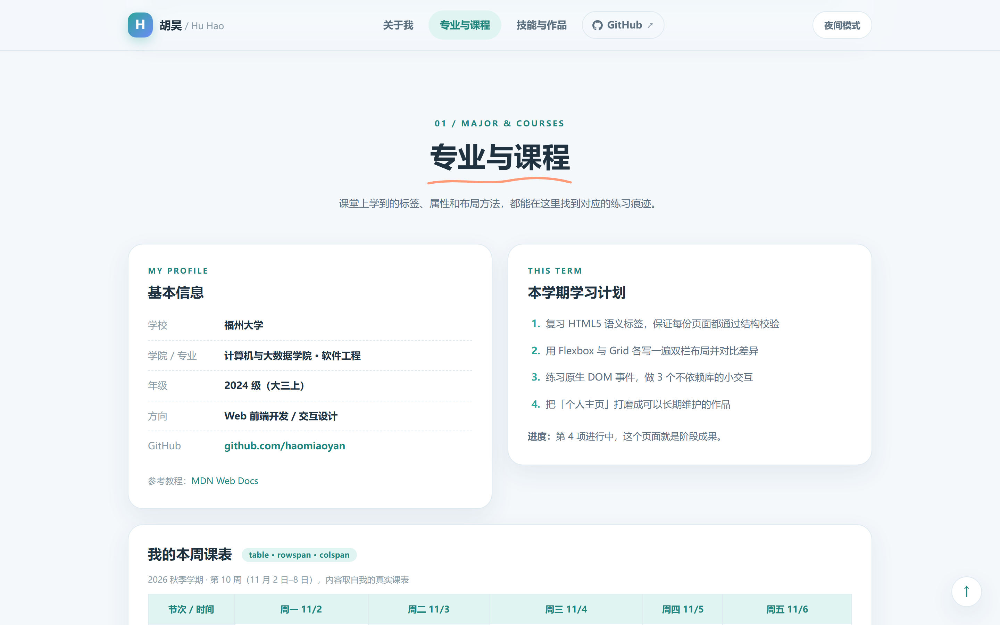
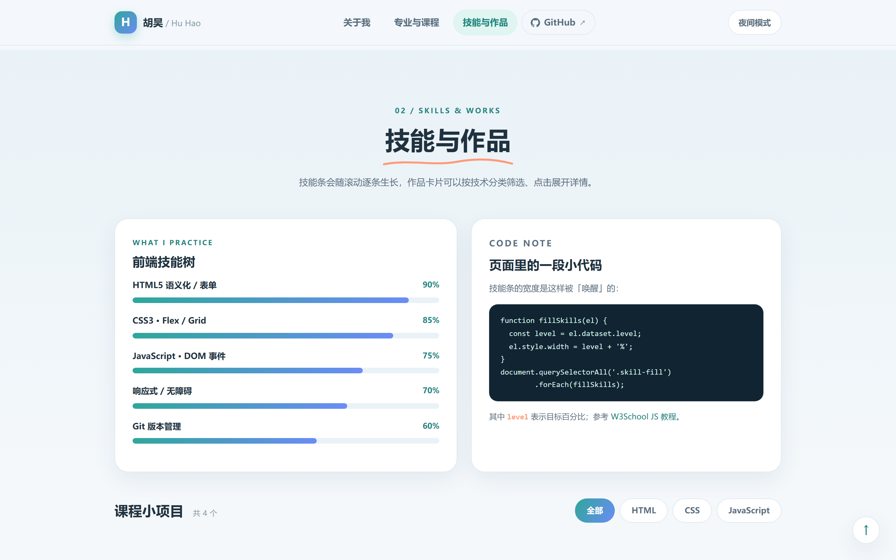
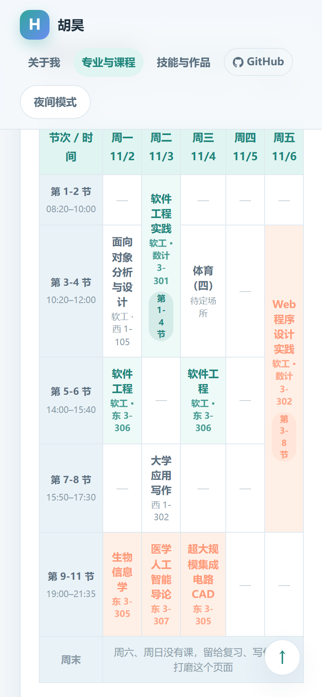

# 胡昊的个人主页 · Personal Homepage

[](https://haomiaoyan.github.io)


福州大学 软件工程 2024 级 · Web Programming 课程作业

纯 HTML + CSS + 原生 JavaScript 写的个人主页：**零依赖、零构建、可离线双击打开**。
分为「关于我」「专业与课程（真实课表）」「技能与作品」三部分。

**线上预览：<https://haomiaoyan.github.io>**


## 预览

| 专业与课程 | 技能与作品 |
| --- | --- |
|  |  |

<p align="center"></p>

## 特性

- **视觉**：浅色清新卡片风，薄荷绿 + 雾蓝双主色，圆角卡片与柔和阴影
- **双主题**：CSS 变量驱动，浅色 / 深色一键切换，选择写入 `localStorage`
- **文字效果**：打字机命令行、渐变流光姓名、标题逐字浮现 + SVG 手绘下划线
- **动效**：滚动揭示（IntersectionObserver）、数字滚动、技能条生长、卡片 3D 倾斜、装饰图形浮动
- **交互**：导航滚动高亮、作品分类筛选、详情弹窗（Esc / 遮罩关闭）、表单原生校验与本地保存、回到顶部
- **响应式**：1024 / 760 / 560 三档断点，手机端单列排布
- **无障碍**：跳转链接、`aria` 标注、`prefers-reduced-motion` 动画降级

## 目录结构

```
.
├── index.html          页面结构（HTML5 语义标签）
├── css/style.css       样式、布局与动画
├── js/main.js          交互逻辑（原生 JS，无第三方库）
├── assets/*.svg        本地插画 6 张，离线可用
└── screenshots/        README 用截图
```

## 运行

直接双击 `index.html` 即可；也可以用静态服务器：

```bash
python -m http.server 8000
```

推荐 Chrome / Edge（用到 CSS 变量、`color-mix()`、`IntersectionObserver` 等现代特性）。

## 用到的知识点

`header/nav/main/section/article/footer` 语义标签 · `table` + `caption` + `rowspan/colspan` 真实课表 ·
`form/fieldset/label/input` 多控件与 `required`/`pattern` 原生校验 · Flexbox / Grid / float 三种布局 ·
`@keyframes`、`transition`、`background-clip: text`、SVG `stroke-dashoffset` 描边动画 ·
原生 DOM 操作、事件监听、`dataset`、`localStorage`、`IntersectionObserver`

## 说明

这是课程作业，页面内容为本人真实的课程安排与学习记录；仓库中不包含学号等个人信息。
